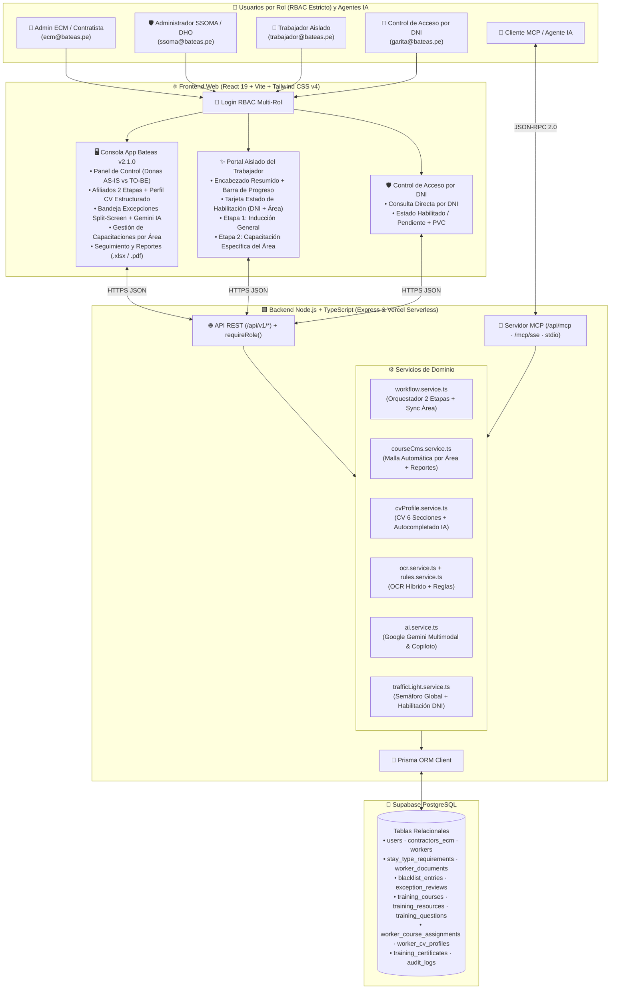
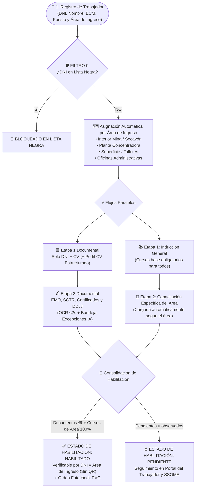

# ⛏️ Bateas Zero-Touch — Onboarding 360 (Equipo MYOPIA)

> **Ideatón William Morris — Copa Emprende 2026 | Minera Bateas S.A.C.**  
> **Reto:** Optimización, Digitalización y Eficiencia de Procesos Empresariales  
> **Cumplimiento Normativo:** **D.S. 024-2016-EM** y Modificatoria **D.S. 023-2017-EM**  
> **Metodología de Ingeniería:** **SDD (Spec-Driven Development)** · **MCP (Model Context Protocol)** · **Zero-Touch Exception Management**

---

## 📋 Tabla de Contenidos
1. [Resumen Ejecutivo y Problemática (AS-IS vs. TO-BE)](#1-resumen-ejecutivo-y-problemática-as-is-vs-to-be)
2. [Funcionalidades Clave y Últimas Actualizaciones (v3.0)](#2-funcionalidades-clave-y-últimas-actualizaciones-v30)
3. [Stack Tecnológico y Herramientas de Desarrollo](#3-stack-tecnológico-y-herramientas-de-desarrollo)
4. [Arquitectura del Sistema y Diagramas Mermaid](#4-arquitectura-del-sistema-y-diagramas-mermaid)
5. [Modelo de Datos Relacional en Supabase PostgreSQL](#5-modelo-de-datos-relacional-en-supabase-postgresql)
6. [Motor OCR Híbrido, Inteligencia Artificial (Google Gemini) y Semáforo Operativo](#6-motor-ocr-híbrido-inteligencia-artificial-google-gemini-y-semáforo-operativo)
7. [Servidor MCP (Model Context Protocol) — Tools y Resources](#7-servidor-mcp-model-context-protocol--tools-y-resources)
8. [Guía de Uso, Credenciales por Rol y Guion de Exposición](#8-guía-de-uso-credenciales-por-rol-y-guion-de-exposición)
9. [Instalación Local, Pruebas Automatizadas y Despliegue en Vercel](#9-instalación-local-pruebas-automatizadas-y-despliegue-en-vercel)
10. [Índice de Documentación SDD y Guías en PDF](#10-índice-de-documentación-sdd-y-guías-en-pdf)

---

## 1. Resumen Ejecutivo y Problemática (AS-IS vs. TO-BE)

En **Minera Bateas S.A.C.**, el proceso de afiliación de **Contratistas Permanentes** (`PERMANENTE CIA`, vínculo mayor a 30 días) constituye el flujo más crítico para la continuidad de los proyectos operativos en **Interior Mina / Socavón**, **Planta Concentradora**, **Superficie / Talleres** y **Oficinas Administrativas**.

Durante la auditoría empírica del entorno real (**App Bateas v2.1.0**) y la validación con el área de **Desarrollo Humano y Organización (DHO)**, se demostró que de un padrón de **3,585 trabajadores contratistas registrados**:
- 🔴 **3,152 trabajadores (87.9%)** presentan al menos un documento vencido.
- 🟡 **51 trabajadores (1.4%)** tienen documentos próximos a vencer en un horizonte de 20 días.
- 🟢 Solo **382 trabajadores (10.7%)** cuentan con toda su documentación vigente.

### Impacto Logrado con **Bateas Zero-Touch (TO-BE)**

| Indicador Operativo (KPI) | Situación Actual (AS-IS) | Con Bateas Zero-Touch (TO-BE) | Impacto en Minera Bateas |
| :--- | :---: | :---: | :--- |
| **Tiempo total de afiliación** | **> 5 días** (impredecible) | **Máximo 48 horas** | Eliminación de lucro cesante por cuadrillas paradas en campamento. |
| **Tiempo de lectura por documento** | **2.5 minutos** (manual) | **< 2 a 10 segundos** (OCR + IA) | Pre-validación automática instantánea al subir el archivo. |
| **Carga operativa de SSOMA / Médico / DHO** | **100%** revisión manual en cadena | **~20%** (Solo Bandeja de Excepciones) | **80% de reducción** en tareas administrativas repetitivas. |
| **Asignación de Capacitaciones** | Inscripción manual y fechas fijas | **100% Automática según Área de Ingreso** | Al registrar o cambiar el área del trabajador, se cargan sus cursos obligatorios. |
| **Control de Acceso y Cierre** | Validación fragmentada | **Estado de Habilitación por DNI y Área + Fotocheck PVC** | Verificación simple (`Habilitado` / `Pendiente`) sin códigos QR. |

---

## 2. Funcionalidades Clave y Últimas Actualizaciones (v3.0)

**Bateas Zero-Touch** se acopla directamente a las tablas maestras de **App Bateas v2.1.0** (`Documentos por estadía` y `Lista negra`) e incorpora las siguientes capacidades productivas:

1. **🛡️ Filtro 0 — Cruce Automático con Lista Negra (En el registro)**:
   - Al registrar el DNI del postulante, el sistema verifica instantáneamente en PostgreSQL si registra bloqueo activo en `blacklist_entries`. Si está en Lista Negra, el Semáforo pasa a **🔴 `ROJO`** y bloquea el proceso.
2. **🟦 Etapa 1 — Primer Filtro Documental (`Solo DNI + CV`) + Perfil CV Estructurado con Gemini IA**:
   - Inicialmente solo se solicita **DNI** y **CV Documentado**, manteniendo **bloqueada con candado (`🔒`) la Etapa 2** (`EMO`, `SCTR`, `Certificados`, `DDJJ`).
   - Los perfiles `SSOMA` y `ECM` cuentan con el modal **Perfil CV Estructurado** (6 secciones editables: Formación académica, Experiencia en minería, Experiencia general, Especializaciones, Certificaciones y Cursos), carga/visor PDF sin sobrescribir cambios manuales y botón opcional **"Autocompletar desde PDF"** impulsado por Google Gemini IA.
3. **🔓 Etapa 2 — Desbloqueo Documental y Gestión por Excepciones Split-Screen**:
   - Al aprobar Etapa 1 (`DNI 🟢 + CV 🟢`), se desbloquea Etapa 2. Los archivos conformes pasan directo a **🟢 `VERDE`**; los vencidos a **🔴 `ROJO`**; y solo los casos con incertidumbre o baja calidad de escaneo pasan a **🟡 `ÁMBAR`** en la **Bandeja de Excepciones** con asistencia de Google Gemini IA.
4. **🗺️ Asignación Automática de Capacitaciones según Área de Ingreso (Sin inscripción manual)**:
   - Cada trabajador está vinculado a su **Área de Ingreso** (`Interior Mina / Socavón`, `Planta Concentradora`, `Superficie / Talleres`, `Oficinas Administrativas`).
   - En **Gestión de Capacitaciones (`SSOMA`)**, cada curso se asocia al área correspondiente (o a *Inducción General* para todas las áreas). Al registrar al trabajador o cambiar su área (`PATCH /api/v1/workers/:workerId/area`), el sistema asigna automáticamente su malla obligatoria:
     - **Etapa 1: Inducción General** (cursos base obligatorios para todos).
     - **Etapa 2: Capacitación Específica del Área** (cursos obligatorios del área de destino).
5. **🪪 Portal Aislado del Trabajador (RBAC Estricto + UI/UX Minimalista)**:
   - Al iniciar sesión con `trabajador@bateas.pe`, el sistema redirige a `/portal-trabajador` sin sidebar administrativo ni visibilidad de terceros.
   - **Encabezado resumido:** nombre, DNI, empresa contratista, área de ingreso asignada y barra de progreso (`"X de Y cursos completados"`).
   - **Tarjetas minimalistas por bloque (`Etapa 1` y `Etapa 2`):** muestran únicamente título, duración en horas, modalidad (`E-learning` o `Presencial`), etiqueta de estado en color suave (`Completado`, `En curso`, `Pendiente`) y un solo botón principal (`Iniciar` o `Continuar`) que abre un modal enfocado de estudio y evaluación.
6. **✅ Estado de Habilitación por DNI y Área (Sin Código QR)**:
   - Se eliminó por completo la generación y visualización de códigos QR / "Pase de Garita".
   - El cierre del flujo presenta una tarjeta simple de **Estado de Habilitación** (`Habilitado` / `Pendiente`) asociada al **DNI** del trabajador y al **Área de Ingreso**, consultable en vivo por DNI desde el perfil **Control de Acceso** (`garita@bateas.pe`) junto con la orden de impresión de **Fotocheck físico en PVC**.
7. **📊 Seguimiento, Reportes Corporativos y Constancias PDF (`SSOMA`)**:
   - Matriz filtrable por contratista y estado, exportación real a **Excel `.xlsx`** (2 hojas: Resumen + Detalle), **PDF Corporativo** consolidado y descarga de **Constancia Oficial PDF** con código de validación textual (sin QR).

---

## 3. Stack Tecnológico y Herramientas de Desarrollo

| Capa | Tecnología / Librería | Propósito en Bateas Zero-Touch |
| :--- | :--- | :--- |
| **Frontend Web (SPA)** | **React 19 + TypeScript + Vite 6** | Interfaz Web Desktop (App Bateas v2.1.0) y Portal Aislado minimalista del Trabajador. |
| **Estilos & Reportes UI** | **Tailwind CSS v4 + Lucide Icons + `xlsx` + `jspdf` + `jspdf-autotable`** | Diseño del Sidebar `#222d32`, Portal Trabajador limpio, exportación Excel/PDF y Constancias oficiales. |
| **Backend & Core Engine** | **Node.js 24 + TypeScript + Express + Multer + Zod** | API REST (`/api/v1/*`), middleware RBAC estricto (`requireRole`), validación de esquemas y orquestación. |
| **Motor OCR Híbrido** | **`pdf-parse` + `zlib` FlateDecode + `tesseract.js` + `pdf-lib`** | Extracción de texto nativo en PDFs (`< 150 ms`), OCR óptico en imágenes (`cachePath: '/tmp'` en Serverless) y PDFs de prueba. |
| **Inteligencia Artificial** | **Google Gemini API** | Fallback multimodal OCR, autocompletado de Perfil CV Estructurado, asistente en Excepciones y Copiloto IA. |
| **Servidor MCP** | **`@modelcontextprotocol/sdk` (v1.11+)** | Servidor **Model Context Protocol** con soporte **`stdio`**, **Streamable HTTP (`/api/mcp`)** y **SSE (`/mcp/sse`)**. |
| **Base de Datos & ORM** | **Supabase PostgreSQL 16 + Prisma ORM 6** | Persistencia relacional ACID con Connection Pooling (`:6543` / `:5432`) y bitácora `audit_logs`. |
| **Despliegue Cloud** | **Vercel Serverless + GitHub CI/CD** | Frontend estático + Backend Express/MCP en `api/index.ts` con `pdf-parse` y Prisma incluidos. |

---

## 4. Arquitectura del Sistema y Diagramas Mermaid

### 4.1. Diagrama de Arquitectura de Componentes



---

### 4.2. Diagrama de Flujo Operativo E2E (Área de Ingreso → Cursos Automáticos → Estado de Habilitación)



---

## 5. Modelo de Datos Relacional en Supabase PostgreSQL

El esquema completo reside en [`packages/backend/prisma/schema.prisma`](packages/backend/prisma/schema.prisma). En la última actualización se incorporaron y extendieron los siguientes modelos clave:

- `enum AccessZone`: `SUPERFICIE`, `SOCAVON`, `PLANTA_CONCENTRADORA`, `OFICINAS_ADMINISTRATIVAS`.
- `training_courses`: incluye `target_area` (`AccessZone?`, donde `NULL` representa **Etapa 1: Inducción General** y un área específica representa **Etapa 2: Capacitación Específica del Área**), `modality` (`VIRTUAL` | `PRESENCIAL`), `duration_hours`, `min_pass_score` y `max_attempts`.
- `training_resources` y `training_questions`: recursos multimedia (`VIDEO`, `PDF`, `PRESENTATION`) y banco de preguntas por curso.
- `worker_course_assignments`: relación automática trabajador–curso con avance en porcentaje, tiempo efectivo, puntaje de evaluación, registro presencial SSOMA y estado (`PENDING`, `IN_PROGRESS`, `COMPLETED`, `FAILED`).
- `worker_cv_profiles`: 6 secciones estructuradas en JSON + PDF opcional + trazabilidad `updated_by` / `updated_at`.
- `training_certificates`: constancias emitidas con `certificate_code`, horas virtuales/presenciales y nota promedio.
- `users`: cuentas con RBAC estricto (`SSOMA`, `ECM`, `GARITA`, `TRABAJADOR`) vinculadas por `worker_id`.

---

## 6. Motor OCR Híbrido, Inteligencia Artificial (Google Gemini) y Semáforo Operativo

1. **Nivel 1 — Decodificación Rápida de PDF (`pdf-parse` + `zlib` FlateDecode)**: Extrae texto embebido de PDFs en `< 150 ms`.
2. **Nivel 2 — Reconocimiento Óptico (`tesseract.js`)**: Procesa imágenes (`PNG`, `JPG`) con `cachePath: '/tmp'` seguro para Vercel Serverless.
3. **Nivel 3 — Fallback Multimodal con Google Gemini IA ([`ai.service.ts`](packages/backend/src/services/ai.service.ts))**: Lectura asistida en documentos complejos, autocompletado opcional del Perfil CV Estructurado desde PDF (`CV_DOC`) y Copiloto IA.
4. **Validación Contextual de Especialidad en el CV**: Verifica competencias clave según puesto y deriva casos atípicos a `ÁMBAR` en Bandeja de Excepciones sin rechazar a ciegas.

---

## 7. Servidor MCP (Model Context Protocol) — Tools y Resources

El backend incluye un servidor **MCP oficial** en [`packages/backend/src/mcp/server.ts`](packages/backend/src/mcp/server.ts) con **8 Tools** (`register_worker`, `analyze_worker_document`, `get_worker_traffic_light`, `list_exception_tray`, `resolve_exception_ticket`, `complete_elearning_simulation`, `verify_garita_qr` —compatible con consulta por DNI—, `generate_demo_scenario`) y **3 Resources** (`bateas://masters/requirements`, `bateas://masters/blacklist`, `bateas://metrics/summary`).

---

## 8. Guía de Uso, Credenciales por Rol y Guion de Exposición

### 8.1. Credenciales Corporativas de Prueba (RBAC Estricto)

| Rol en la Plataforma | Correo | Contraseña | Vista / Alcance |
| :--- | :---: | :---: | :--- |
| **1. Administrador SSOMA / DHO** | `ssoma@bateas.pe` | `Bateas2026!` | Panel KPIs, Excepciones IA, Gestión de Capacitaciones por Área, Seguimiento/Reportes (`.xlsx`/`.pdf`), Perfil CV, Maestros. |
| **2. Administrador ECM / Contratista** | `ecm@bateas.pe` | `Bateas2026!` | Afiliar postulantes con Área de Ingreso, Etapa 1 (`DNI + CV`), Etapa 2 (`EMO`, `SCTR`), Perfil CV Estructurado. |
| **3. Trabajador (Portal Aislado)** | `trabajador@bateas.pe` | `Bateas2026!` | Vista limpia sin sidebar: Resumen + Estado de Habilitación (DNI + Área), Etapa 1 General y Etapa 2 Específica del Área. |
| **4. Control de Acceso (Garita)** | `garita@bateas.pe` | `Bateas2026!` | Consulta directa de **Estado de Habilitación** (`Habilitado` / `Pendiente`) por **DNI** y Área de Ingreso + cola PVC (sin QR). |

### 8.2. Recorrido Rápido de Demostración (4 Minutos)
1. **Panel de Control (`ssoma@bateas.pe`)**: Mostrar donas comparativas (`87.9%` vencidos AS-IS vs. Motor Zero-Touch TO-BE).
2. **Afiliación por Área + Perfil CV (`Afiliados`)**: Registrar o seleccionar un trabajador, mostrar el filtro en 2 etapas, abrir **Perfil CV Estructurado** y cambiar el selector **Área de ingreso** para ver la reasignación automática de cursos.
3. **Gestión de Capacitaciones por Área (`SSOMA`)**: Mostrar la asociación de cursos a cada área (*Inducción General*, *Interior Mina / Socavón*, *Planta Concentradora*, *Superficie / Talleres*, *Oficinas Administrativas*) y la exportación Excel/PDF en **Seguimiento y Reportes**.
4. **Portal del Trabajador (`trabajador@bateas.pe`)**: Mostrar la interfaz minimalista sin sidebar, barra de progreso (`"X de Y cursos completados"`), tarjeta de **Estado de Habilitación** sin QR y bloques **Etapa 1** y **Etapa 2**.
5. **Control de Acceso por DNI (`garita@bateas.pe`)**: Consultar un trabajador por su DNI de 8 dígitos para validar su estado `Habilitado` o `Pendiente` y su área asignada.

---

## 9. Instalación Local, Pruebas Automatizadas y Despliegue en Vercel

```bash
# 1. Instalar dependencias del monorepo
npm install

# 2. Sincronizar esquema Prisma con Supabase PostgreSQL y sembrar datos por área
npm run db:push
npm run db:seed

# 3. Ejecutar pruebas SDD y compilación
npm --workspace=packages/backend run test
npx --workspace=packages/backend tsx src/tests/verify-mcp.ts
npm run build:frontend

# 4. Levantar servidores en desarrollo
npm run dev:backend   # API REST en http://localhost:4000/api/v1 y MCP en http://localhost:4000/api/mcp
npm run dev:frontend  # Web App en http://localhost:5173
```

---

## 10. Índice de Documentación SDD y Guías en PDF

- 📗 **[Documento Maestro de Arquitectura y Producto (v3.0)](docs/DOCUMENTO_MAESTRO_BATEAS_ZEROTOUCH.md)**
- 📘 **[Manual de Usuario Base (PDF)](docs/Guia_Usuario_Bateas_ZeroTouch_Equipo_Myopia.pdf)**
- 📐 **Especificaciones Técnicas SDD (`docs/specs/`)**:
  - [Spec 01 — Arquitectura del Sistema y Diagramas de Flujo](docs/specs/01-arquitectura-y-flujos.md)
  - [Spec 02 — Esquema PostgreSQL y Prisma ORM](docs/specs/02-esquema-postgres-prisma.md)
  - [Spec 03 — Motor OCR, Reglas de Perfil/Vigencia y Semáforo Operativo](docs/specs/03-motor-ocr-reglas-semaforo.md)
  - [Spec 04 — Contratos API REST y Servidor MCP](docs/specs/04-contratos-api-y-mcp.md)
  - [Spec 05 — Frontend Web Corporativo, Portal del Trabajador y Estado de Habilitación](docs/specs/05-frontend-react-y-carnet-qr.md)
