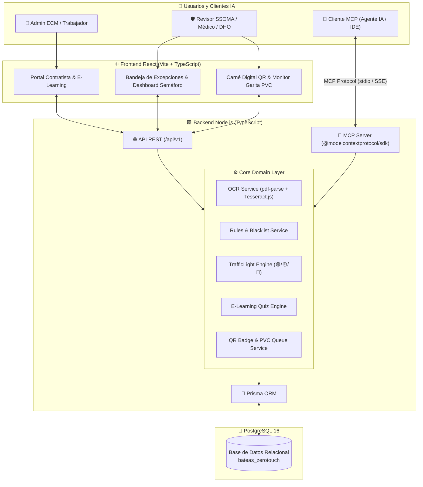
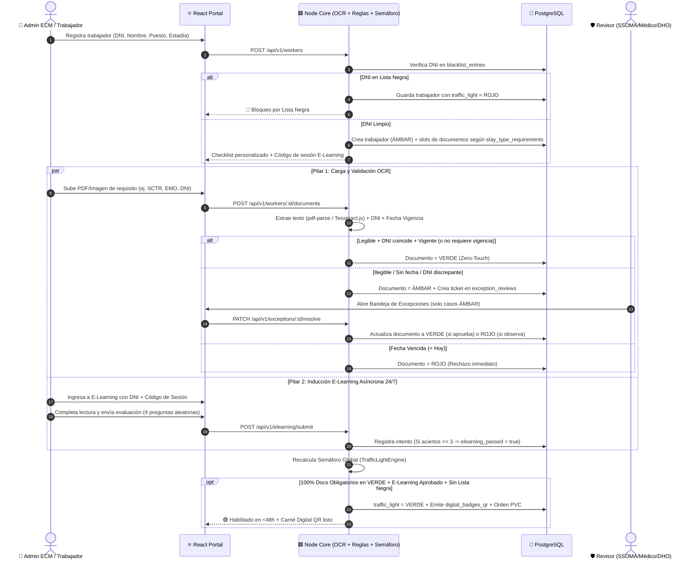

# Spec 01 — Arquitectura del Sistema y Diagramas de Flujo (SDD)

## 1. Estructura del Monorepo (React + Node.js + MCP + PostgreSQL)

```text
ZeroTrust/
├── docker-compose.yml                  # PostgreSQL 16 + pgAdmin opcional
├── package.json                        # Workspaces (backend, frontend)
├── docs/
│   ├── DOCUMENTO_MAESTRO_BATEAS_ZEROTOUCH.md
│   └── specs/
│       ├── 01-arquitectura-y-flujos.md
│       ├── 02-esquema-postgres-prisma.md
│       ├── 03-motor-ocr-reglas-semaforo.md
│       ├── 04-contratos-api-y-mcp.md
│       └── 05-frontend-react-y-carnet-qr.md
├── packages/
│   ├── backend/                        # Node.js + TypeScript + Prisma + Express + MCP
│   │   ├── prisma/
│   │   │   ├── schema.prisma           # Esquema PostgreSQL compatible con Spring Boot JPA
│   │   │   └── seed.ts                 # Maestros de App Bateas v2.1.0 + Lista Negra + Demos
│   │   └── src/
│   │       ├── config/                 # Variables de entorno y conexión Prisma
│   │       ├── services/               # Core Domain (compartido por REST API y MCP Server)
│   │       │   ├── ocr.service.ts      # pdf-parse + tesseract.js + regex DNI/Fechas
│   │       │   ├── rules.service.ts    # Validación de vigencias, DNI y Lista Negra
│   │       │   ├── trafficLight.service.ts # Máquina de estados VERDE/AMBAR/ROJO
│   │       │   ├── elearning.service.ts    # Sesiones y evaluación aleatoria
│   │       │   └── qrBadge.service.ts      # Emisión de Carné Digital QR + Cola PVC
│   │       ├── api/                    # Rutas REST (/api/v1/*) para React
│   │       ├── mcp/                    # Servidor MCP (@modelcontextprotocol/sdk)
│   │       │   └── server.ts           # Tools, Resources y Prompts
│   │       └── index.ts                # Entrypoint HTTP + SSE MCP
│   └── frontend/                       # React 19 + TypeScript + Vite + Tailwind CSS
│       └── src/
│           ├── pages/
│           │   ├── contractor/         # Portal ECM y Aula E-Learning Trabajador
│           │   ├── reviewer/           # Bandeja de Excepciones (SSOMA/Médico/DHO) + KPIs
│           │   └── gatehouse/          # Visor de Carné Digital QR y Cola Fotocheck PVC
│           └── components/
```

---

## 2. Diagrama de Arquitectura de Componentes



---

## 3. Flujo Operativo Zero-Touch Puro (To-Be)


